  <a href="https://lautaro-villalba-portfolio.web.app">Portfolio</a> ·
  <a href="mailto:lautarovillalbafabricio@gmail.com">Mail</a> ·
  <a href="https://www.linkedin.com/in/lautaro-villalba/">LinkedIn</a>

<b>English</b>

### Hi

I'm Lautaro Villalba. I build cloud data platforms on GCP: ingestion, modelling and automation, so marketing and product data reach the people who decide, clean and on time. Roles: BI Analyst, MarTech and Analytics Engineer.

### Stack

| Group | Tools |
| --- | --- |
| Modelling and query | `dbt` `BigQuery` |
| Orchestration and infrastructure | `Airflow` `GCS` `Cloud Run` `CI/CD` `Firebase` |
| MarTech and analytics | `GA4` `GTM` `Google Ads` `Meta Ads` `Braze` `Amplitude` `Looker Studio` `Slack bots` |
| Apps and AI | `Python` `FastAPI` `React` `Vite` `Vertex AI` |

### Selected work

Clients are described by industry, without names. Full cases are in the [portfolio](https://lautaro-villalba-portfolio.web.app).

- **Veko Producciones**: events company. Website, tracking, a quoting bot, Airbnb and designs, automated wherever possible.
- **End to end digital tracking**: from the first tag to the dashboard.
- **itti**: in house data and MarTech team for a group of digital businesses.
- **Rubik Cloud**: data, analytics and product projects for clients across industries.
- **Media agency**: a reporting app that grew from one client to several.
- **360 platform app**: an iPhone app that records, edits and delivers the video to the guest with a QR code.
- **Restaurant chain**: point of sale and delivery data in BigQuery, segmented customers and campaigns.
- **Car dealerships**: measurement and Google Ads, manual today and heading toward automation.

### Contact

[lautarovillalbafabricio@gmail.com](mailto:lautarovillalbafabricio@gmail.com) · [LinkedIn](https://www.linkedin.com/in/lautaro-villalba/) · [Portfolio](https://lautaro-villalba-portfolio.web.app)

